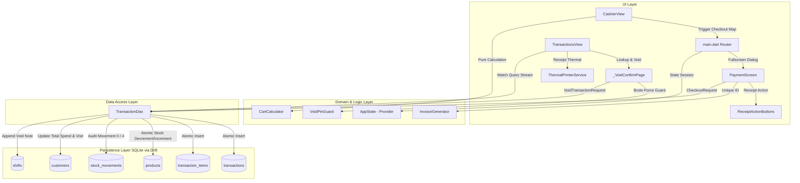
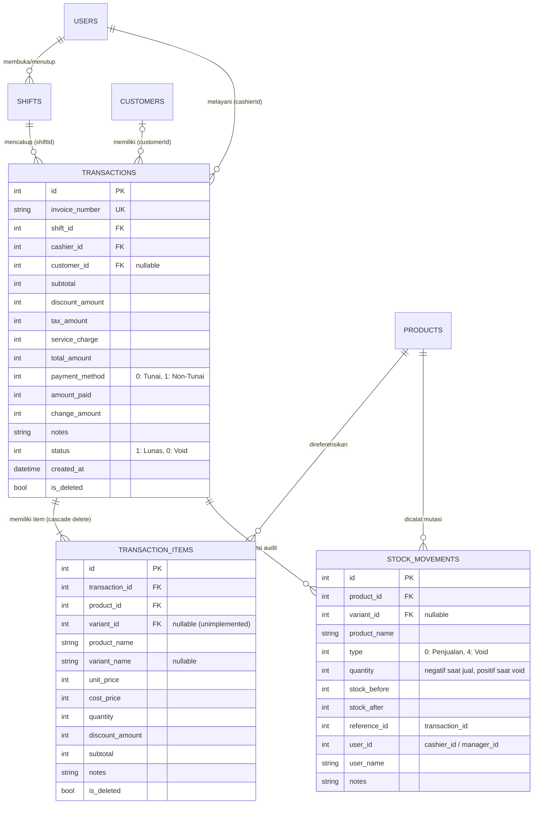

# LAPORAN AUDIT SISTEM, ARSITEKTUR, DAN PENGUJIAN QA
## Fitur Kasir (Cashier/POS) & Transaksi (Transaction Management)
**Sistem**: MyPOS Retail POS Flutter Edition  
**Versi Basis Kode**: 1.0.0+1 (Database Schema v8)  
**Tanggal Audit**: 13 Oktober 2026  
**Peran Auditor**: System Analyst, Project Manager, QA Auditor & Tester Lead  

---

## DAFTAR ISI
1. [Ringkasan Eksekutif (Executive Summary)](#1-ringkasan-eksekutif-executive-summary)
2. [Arsitektur Sistem: Kasir & Transaksi (System Analyst View)](#2-arsitektur-sistem-kasir--transaksi-system-analyst-view)
   - 2.1 Diagram Arsitektur & Pola Aliran Data
   - 2.2 Skema Entitas Relasional (ERD) & Struktur Database
   - 2.3 Mekanisme State Management & Reaktivitas Drift SQLite
3. [Cara Kerja & Siklus Hidup Operasional (Workflow Lifecycle)](#3-cara-kerja--siklus-hidup-operasional-workflow-lifecycle)
   - 3.1 Siklus Checkout & Mesin Kalkulasi (`CartCalculator`)
   - 3.2 Siklus Eksekusi Pembayaran & Pemotongan Stok Atomik
   - 3.3 Siklus Manajemen Riwayat Transaksi & Pencetakan Struk
   - 3.4 Siklus Pembatalan Transaksi (Void & Restitusi Stok)
4. [Detail Hubungan & Ketergantungan Antara Kasir dan Transaksi](#4-detail-hubungan--ketergantungan-antara-kasir-dan-transaksi)
   - 4.1 Kontrak Data Antarmuka
   - 4.2 Siklus Kasir sebagai *Producer* dan Transaksi sebagai *Consumer/Mutator*
   - 4.3 Keterikatan dengan Modul Shift, Inventori, dan CRM
5. [Audit Mendalam: Temuan Defect, Celah Sistem, & Risiko (QA Auditor View)](#5-audit-mendalam-temuan-defect-celah-sistem--risiko-qa-auditor-view)
   - 5.1 [CRITICAL] Penghapusan Keranjang Belanja Saat Pembayaran Dibatalkan
   - 5.2 [HIGH] Pembatalan Shift Meninggalkan Transaksi Yatim (*Orphaned Transactions*)
   - 5.3 [HIGH] Ketidaksinkronan Rekonsiliasi Kas Historis Saat Transaksi Di-Void Pasca Tutup Shift
   - 5.4 [MEDIUM] Omission *Service Charge* pada Ringkasan Pesanan `PaymentScreen`
   - 5.5 [MEDIUM] Asimetri Fitur Cetak Struk (PDF Tersedia di Pembayaran, Hilang di Riwayat Transaksi)
   - 5.6 [MEDIUM] Kerentanan Bypass Brute Force Guard Void Melalui Restart Aplikasi
   - 5.7 [LOW/DEBT] Varian Produk (*Ghost Schema* & Unimplemented Feature)
6. [Evaluasi Technical Debt & Manajemen Proyek (Project Manager View)](#6-evaluasi-technical-debt--manajemen-proyek-project-manager-view)
   - 6.1 Kode Yatim Raksasa: `PaymentModal` (1.648 Baris / 65 KB Dead Code)
   - 6.2 Kekosongan Automated Test Suite (Zero Test Coverage)
   - 6.3 Matriks Penilaian Risiko Bisnis & Operasional
7. [Matriks Pengujian QA (Comprehensive Test Matrix)](#7-matriks-pengujian-qa-comprehensive-test-matrix)
   - 7.1 Test Matrix: Fitur Kasir & Cart
   - 7.2 Test Matrix: Fitur Pembayaran
   - 7.3 Test Matrix: Fitur Riwayat & Void
   - 7.4 Test Matrix: Edge Cases, Concurrency & Hardware Failures
8. [Rencana Aksi & Roadmap Rekomendasi (Actionable Roadmap)](#8-rencana-aksi--roadmap-rekomendasi-actionable-roadmap)

---

## 1. Ringkasan Eksekutif (Executive Summary)

Audit komprehensif ini dilakukan terhadap implementasi fitur **Kasir** (`cashier_view.dart`, `payment_screen.dart`, `cart_calculator.dart`) dan **Transaksi** (`transactions_view.dart`, `transaction_dao.dart`, `receipt_action_buttons.dart`, `thermal_printer_service.dart`) pada aplikasi POS berbasis Flutter.

### Evaluasi Lintas Peran:

| Peran | Penilaian | Ringkasan Temuan |
| :--- | :---: | :--- |
| **System Analyst** | **Baik (dengan celah kontrak)** | Arsitektur persistensi menggunakan **Drift SQLite dengan mode WAL** sangat solid. Pemotongan stok di level SQL atomik berhasil mencegah *race condition*. Namun, terdapat cacat pada kontrak navigasi antara Kasir dan Layar Pembayaran yang menyebabkan hilangnya data keranjang belanja secara prematur saat pengguna membatalkan dialog pembayaran. |
| **Project Manager** | **Sedang (Technical Debt Tinggi)** | Terdapat kode yatim (*orphaned code*) berukuran 65 KB (`payment_modal.dart`) yang tidak digunakan dalam alur produksi. Modul varian produk tercatat di skema database dan model DAO namun tidak diimplementasikan di UI. Zero automated tests menimbulkan risiko regresi tinggi pada rilis berikutnya. |
| **QA Auditor & Tester** | **Perlu Perbaikan Segera (P0 Defect)** | Ditemukan 1 bug kritis (**Cart Wiped Out on Cancel**), 2 bug berisiko tinggi terkait integritas data rekonsiliasi kas shift, 1 inkonsistensi rendering matematis (omisi service charge di layar pembayaran), dan celah keamanan sesi brute-force guard pada otorisasi void. |

---

## 2. Arsitektur Sistem: Kasir & Transaksi (System Analyst View)

### 2.1 Diagram Arsitektur & Pola Aliran Data

Fitur Kasir dan Transaksi dirancang dengan pola *Layered Architecture* yang memanfaatkan *Reactive Local-First SQLite Database*:



### 2.2 Skema Entitas Relasional (ERD) & Struktur Database

Hubungan data inti berpusat pada tabel `Transactions` dan `TransactionItems` dengan referensi integritas referensial:



### 2.3 Mekanisme State Management & Reaktivitas Drift SQLite

1. **Drift Streams (`.watch()`)**:
   - `CashierView` mengamati katalog `products`, `categories`, dan `customers` melalui stream terpisah yang diinisialisasi sekali di `didChangeDependencies` untuk mencegah memory leak.
   - `TransactionsView` memantau query reaktif `transactions` terurut menurun berdasarkan waktu transaksi (`createdAt DESC`).
2. **Pragma SQLite Engine**:
   - SQLite dikonfigurasi dengan:
     ```sql
     PRAGMA journal_mode = WAL;
     PRAGMA synchronous = NORMAL;
     PRAGMA busy_timeout = 5000;
     PRAGMA foreign_keys = ON;
     ```
   - Mode **WAL (Write-Ahead Logging)** memungkinkan *read concurrency* tinggi saat kasir sedang memproses checkout di thread latar belakang (*background executor* via `NativeDatabase.createInBackground`).
3. **Penyekatan State Transaksi**:
   - Status keranjang belanja disimpan secara lokal di `_CashierViewState._cartItems` sebagai `List<CartItem>` sebelum diserahkan ke `PaymentScreen` melalui *payload Map*.

---

## 3. Cara Kerja & Siklus Hidup Operasional (Workflow Lifecycle)

### 3.1 Siklus Checkout & Mesin Kalkulasi (`CartCalculator`)

Proses perhitungan biaya dilakukan oleh modul murni teruji `CartCalculator.calculate()`:
1. **Validasi Item Cart**: Item dengan $qty \le 0$ atau harga $< 0$ diabaikan secara defensif.
2. **Subtotal**: $\sum (\text{sellingPrice} \times \text{quantity})$.
3. **Diskon Promo**:
   - Promo divalidasi apakah aktif (`isActive == true`), tidak dihapus (`isDeleted == false`), serta berada dalam rentang tanggal `startDate` dan `endDate`.
   - Cek batas minimum pembelian (`subtotal >= promo.minPurchase`).
   - Tipe Nominal: $\min(\text{discountValue}, \text{subtotal})$.
   - Tipe Persentase: $\lfloor \text{subtotal} \times \frac{\text{clamp}(0, \text{discountValue}, 100)}{100} \rceil$.
4. **Service Charge**: Nilai flat hanya diterapkan jika $\text{subtotalAfterPromo} > 0$.
5. **PPN (Pajak)**:
   $$\text{taxAmount} = \lfloor (\text{subtotalAfterPromo} + \text{serviceCharge}) \times \frac{\text{taxRatePercent}}{100} \rceil$$
6. **Grand Total**: $\max(0, \text{subtotalAfterPromo} + \text{serviceCharge} + \text{taxAmount})$.

### 3.2 Siklus Eksekusi Pembayaran & Pemotongan Stok Atomik

Ketika tombol "Bayar" di `PaymentScreen` dieksekusi:
1. **Validasi Input Moneter**:
   - Cek uang tunai $\ge$ total tagihan.
   - Cek batas moneter maksimum `MoneyLimits.maxPaymentAmount` (Rp 999.999.999).
2. **Generasi Nomor Invoice Unik**:
   - Menggunakan `InvoiceGenerator.generate()` dengan format `INV-{yyMMdd}-{mmss.SSS}-{rand}` (collision-resistant).
3. **Transaksi Database Terisolasi (`TransactionDao.checkout`)**:
   - Seluruh operasi dibungkus dalam `transaction(...)` dengan batas waktu timeout 10 detik (`_runTransactionWithTimeout`).
   - **Pemotongan Stok Atomik**:
     ```sql
     UPDATE products 
     SET current_stock = current_stock - ?, updated_at = ? 
     WHERE id = ? AND current_stock >= ?;
     ```
     Jika baris terpengaruh bernilai 0 (`updateCount == 0`), transaksi langsung melempar `StateError('Stok produk tidak cukup')` dan di-*rollback* total.
   - **Pencatatan Audit Trail**:
     - Baris `transaction_items` disimpan dengan membekukan harga modal (`costPrice`) dan harga jual (`unitPrice`) saat transaksi terjadi.
     - Baris `stock_movements` dibuat dengan kuantitas negatif, mencatat `stockBefore`, `stockAfter`, `referenceId = transactionId`, serta `userName = cashierName`.
   - **Update CRM**: Jika ada `customerId`, akumulasi `totalSpend` dan `visitCount` diperbarui di tabel `customers`.

### 3.3 Siklus Manajemen Riwayat Transaksi & Pencetakan Struk

1. **Penyajian Data**:
   - `TransactionsView` mendukung tampilan responsif: Master-Detail Split Table pada Desktop/Tablet dan Card List dengan Animated Modal Bottom Sheet pada perangkat Mobile.
   - Terdapat filter rentang waktu: Hari Ini, 7 Hari Terakhir, Bulan Ini, dan Semua (dibatasi 500 baris untuk efisiensi memori).
2. **Pencetakan Struk**:
   - **Cetak Thermal (Bluetooth ESC/POS 58mm)**:
     - Mengirim byte command ESC/POS melalui library `print_bluetooth_thermal`.
     - Otomatis memicu perintah potong kertas (`PosCutMode.full`) dan pembukaan laci kas (`PosDrawer.pin2`) **khusus** untuk transaksi tunai (`paymentMethod == 0`).
   - **Cetak PDF**:
     - Mengenerate dokumen PDF monospaced 72mm dengan `pdf/widgets.dart` dan mencetaknya via `Printing.layoutPdf`.

### 3.4 Siklus Pembatalan Transaksi (Void & Restitusi Stok)

1. **Gate Otorisasi Keamanan**:
   - Transaksi hanya bisa di-void jika berstatus lunas (`status == 1`).
   - Membutuhkan otorisasi PIN dari User ber-role Manager (role 1) atau Owner (role 0).
   - Dilindungi oleh pengaman brute-force `VoidPinGuard` (maksimal 5 kali salah sebelum terkunci selama 1 menit).
2. **Operasi Database Atomik (`TransactionDao.voidTransaction`)**:
   - Status transaksi diubah menjadi `status = 0` (Void) dan kolom catatan diisi `VOID: {alasan}`.
   - Restitusi Stok Atomik:
     ```sql
     UPDATE products 
     SET current_stock = current_stock + ?, updated_at = ? 
     WHERE id = ?;
     ```
   - Log `stock_movements` baru dibuat dengan tipe `type = 4` (Void) dan mencatat nama manajer yang menyetujui.
   - Pembalikan statistik CRM pelanggan (`totalSpend` dikurangi, `visitCount` dikurangi dengan `clamp(0, ...)`).
   - Penambahan catatan koreksi pada `shifts.notes` jika transaksi awal adalah tunai.

---

## 4. Detail Hubungan & Ketergantungan Antara Kasir dan Transaksi

Hubungan kedua modul ini bersifat **Producer-Consumer & Mutation Lifecycle**:

| Dimensi | Modul Kasir (`CashierView` & `PaymentScreen`) | Modul Transaksi (`TransactionsView` & `TransactionDao`) |
| :--- | :--- | :--- |
| **Peran Utama** | *Producer*: Membentuk keranjang belanja, memvalidasi diskon, menerima uang, dan menerbitkan invoice. | *Consumer & Mutator*: Mengarsipkan, memvisualisasikan nota, mencetak ulang, dan membatalkan (void). |
| **Akses Data** | Read-Heavy pada Katalog Produk, Promo, dan Pelanggan. Write-Single pada Transaksi Baru. | Read-Heavy pada Riwayat Transaksi & Item. Write-Targeted pada Pembalikan Status Transaksi & Stok. |
| **Titik Hubung** | Mengirimkan payload Map ke `PaymentScreen` yang mengeksekusi `TransactionDao.checkout()`. | Membaca record yang dihasilkan oleh `checkout()` dan mengeksekusi `TransactionDao.voidTransaction()`. |
| **Dampak Stok** | Mengurangi stok fisik dan menciptakan log mutasi penjualan. | Mengembalikan stok fisik dan menciptakan log mutasi void. |
| **Dampak Shift** | Menambah akumulasi `_totalCash` dan `_totalNonCash` di shift kasir berjalan. | Membatalkan kontribusi kas di shift dan mencatat log void di catatan shift. |

---

## 5. Audit Mendalam: Temuan Defect, Celah Sistem, & Risiko (QA Auditor View)

Hasil audit kode mendalam mengidentifikasi beberapa cacat arsitektur dan fungsional yang diklasifikasikan berdasarkan tingkat keparahan (*severity*):

### 5.1 [CRITICAL] Penghapusan Keranjang Belanja Saat Pembayaran Dibatalkan

- **Lokasi Kode**: 
  - [`lib/screens/cashier_view.dart:293-310`](file:///d:/IT/Software%20Engineer/mobile/MyPos/lib/screens/cashier_view.dart#L293-L310)
  - [`lib/main.dart:300-315`](file:///d:/IT/Software%20Engineer/mobile/MyPos/lib/main.dart#L300-L315)
- **Deskripsi Masalah**:
  Di `CashierView`, saat kasir menekan tombol "Lanjut ke Pembayaran", callback `widget.onPaymentTrigger` dipanggil. Di `main.dart`, layar `PaymentScreen` dibuka dengan `Navigator.push<bool>`. Jika kasir menekan tombol silang 'X' di AppBar `PaymentScreen` atau tombol *Back* Android, layar mengembalikan `false` atau `null`. Namun di `cashier_view.dart`, blok kode berikut dieksekusi **tanpa memeriksa status keberhasilan**:
  ```dart
  await widget.onPaymentTrigger({...});
  if (mounted) {
    setState(() {
      _cartItems.clear(); // <-- BUG KRITIS: Keranjang dihapus membabi buta!
      _activePromo = null;
      _selectedCustomerId = '';
    });
  }
  ```
- **Dampak Bisnis & Operasional**:
  Jika kasir tidak sengaja menekan tombol batal, atau pelanggan ingin menambah item belanjaan di detik terakhir pembayaran, **seluruh keranjang belanjaan hilang seketika**. Kasir harus memindai atau memilih ulang puluhan item dari awal. Hal ini menyebabkan antrian macet dan frustrasi kasir.
- **Rekomendasi Perbaikan**:
  Ubah tipe kontrak `onPaymentTrigger` menjadi `Future<bool> Function(Map<String, dynamic> cart)`. Kosongkan keranjang **hanya jika** hasil return bernilai `true`.

---

### 5.2 [HIGH] Pembatalan Shift Meninggalkan Transaksi Yatim (*Orphaned Transactions*)

- **Lokasi Kode**: [`lib/screens/shift_view.dart:303-306`](file:///d:/IT/Software%20Engineer/mobile/MyPos/lib/screens/shift_view.dart#L303-L306)
- **Deskripsi Masalah**:
  Fitur pembatalan shift (`_handleCancelShiftSubmit`) mengizinkan manajer membatalkan shift dengan soft-delete (`isDeleted = true`). Namun, sistem **sama sekali tidak memvalidasi apakah shift tersebut sudah memiliki transaksi**.
- **Dampak Bisnis & Operasional**:
  Jika kasir sudah menjual 10 transaksi lunas, lalu shift dibatalkan, transaksi tersebut tetap tercatat sebagai transaksi aktif (`isDeleted = false, status = 1`), tetapi merujuk pada `shiftId` yang telah dihapus. Saat tutup buku harian atau ekspor laporan shift, uang fisik dari 10 transaksi ini tidak memiliki induk shift resmi, menyebabkan ketidaksesuaian pembukuan (*financial discrepancy*).
- **Rekomendasi Perbaikan**:
  Tambahkan validasi: Jika shift sudah memiliki transaksi aktif ($\text{count} > 0$), tolak pembatalan shift dan wajibkan proses *Tutup Shift Resmi* (*Close Shift*).

---

### 5.3 [HIGH] Ketidaksinkronan Rekonsiliasi Kas Historis Saat Transaksi Di-Void Pasca Tutup Shift

- **Lokasi Kode**: [`lib/core/database/daos/transaction_dao.dart:321-337`](file:///d:/IT/Software%20Engineer/mobile/MyPos/lib/core/database/daos/transaction_dao.dart#L321-L337)
- **Deskripsi Masalah**:
  `TransactionDao.voidTransaction()` mengizinkan pembatalan transaksi kapan saja tanpa membatasi apakah shift terkait masih berstatus buka (`status == 0`) atau sudah ditutup (`status == 1`). Jika transaksi dari shift kemarin di-void hari ini, DAO hanya meng-*append* string teks `VOID Transaksi #...` pada kolom catatan shift lama. Nilai `closingCash` fisik yang sudah dicatat kemarin tidak berubah.
- **Dampak Bisnis & Operasional**:
  Laporan keuangan shift kemarin yang sudah diaudit dan disetor menjadi tidak cocok dengan rekap mutasi transaksi. Selain itu, uang pengembalian (*refund*) yang dikeluarkan dari laci kas hari ini tidak tercatat di shift kasir yang sedang aktif.
- **Rekomendasi Perbaikan**:
  Batasi void transaksi hanya untuk transaksi pada shift yang sedang aktif. Untuk transaksi pada shift yang sudah tutup buku, gunakan mekanisme formal **Retur / Refund Modul Kas Keluar**.

---

### 5.4 [MEDIUM] Omission *Service Charge* pada Ringkasan Pesanan `PaymentScreen`

- **Lokasi Kode**: [`lib/screens/payment_screen.dart:280-316`](file:///d:/IT/Software%20Engineer/mobile/MyPos/lib/screens/payment_screen.dart#L280-L316)
- **Deskripsi Masalah**:
  Pada komponen `orderSummary` di `PaymentScreen`, terdapat baris:
  - Subtotal
  - Diskon (jika ada)
  - Pajak (jika ada)
  - Total Pembayaran
  
  Baris **Service Charge tidak dirender sama sekali**, padahal nilainya diikutsertakan dalam kalkulasi `_total = widget.cart['totalAmount']`.
- **Dampak Pengguna**:
  Kasir atau pelanggan melihat ketidaksinkronan hitungan matematis. Contoh: Subtotal Rp 100.000 + PPN Rp 11.000 = tertulis Total Rp 113.000 (karena ada Service Charge Rp 2.000 tersembunyi). Hal ini memicu kecurigaan pelanggan atas markup harga liar.
- **Rekomendasi Perbaikan**:
  Tambahkan baris render `widget.cart['serviceCharge']` secara kondisional di antara baris Diskon dan Pajak.

---

### 5.5 [MEDIUM] Asimetri Fitur Cetak Struk (PDF Tersedia di Pembayaran, Hilang di Riwayat Transaksi)

- **Lokasi Kode**: [`lib/screens/transactions_view.dart:1185-1243`](file:///d:/IT/Software%20Engineer/mobile/MyPos/lib/screens/transactions_view.dart#L1185-L1243)
- **Deskripsi Masalah**:
  Saat transaksi baru selesai di `PaymentScreen`, kasir disajikan widget `ReceiptActionButtons` yang memiliki 2 opsi cetak: **Cetak Thermal** dan **Cetak PDF**. Namun, di layar Riwayat Transaksi (`TransactionsView`), tombol cetak struk **hanya mendukung printer bluetooth thermal**. Opsi cetak PDF sama sekali tidak disediakan.
- **Dampak Operasional**:
  Jika printer thermal rusak, kehabisan baterai, atau pelanggan meminta struk digital (dikirim via WhatsApp/Email), kasir tidak bisa mengekspor struk PDF dari transaksi lampau.
- **Rekomendasi Perbaikan**:
  Gunakan komponen `ReceiptActionButtons` di `TransactionsView` atau tambahkan tombol cetak PDF memanfaatkan `PdfReceiptService.generateReceipt()`.

---

### 5.6 [MEDIUM] Kerentanan Bypass Brute Force Guard Void Melalui Restart Aplikasi

- **Lokasi Kode**: [`lib/core/utils/void_pin_guard.dart:1-54`](file:///d:/IT/Software%20Engineer/mobile/MyPos/lib/core/utils/void_pin_guard.dart#L1-L54)
- **Deskripsi Masalah**:
  `VoidPinGuard` menyimpan penghitung kegagalan `_attempts` dan waktu `_lockoutUntil` secara in-memory (RAM) di dalam State `_TransactionsViewState`.
- **Celah Keamanan**:
  Kasir yang mencoba menebak PIN manajer dan terkena lockout 1 menit dapat langsung menutup paksa aplikasi (*force stop/restart*). Saat aplikasi dibuka kembali, counter brute-force kembali menjadi 0.
- **Rekomendasi Perbaikan**:
  Persistensikan state lockout ke `SharedPreferences` seperti yang sudah dilakukan pada `BruteForceGuard` di `auth_screen.dart`.

---

### 5.7 [LOW/DEBT] Varian Produk (*Ghost Schema* & Unimplemented Feature)

- **Lokasi Kode**: `product_variants_table.dart`, `transaction_items_table.dart:12-15`, `transaction_dao.dart:20-21`
- **Deskripsi Masalah**:
  Skema database mendukung varian produk lengkap dengan kolom `variant_id` dan `variant_name` pada tabel `transaction_items` dan `stock_movements`. Namun, di antarmuka Kasir (`cashier_view.dart`), model cart (`cart_item.dart`), dan alur checkout, fitur varian produk tidak diimplementasikan. Nilai `variantId` selalu diisi `null`.
- **Dampak**:
  Menyebabkan beban kompleksitas pada DAO dan skema tanpa memberikan nilai fungsional bagi bisnis retail yang membutuhkan varian (ukuran, warna, rasa).

---

## 6. Evaluasi Technical Debt & Manajemen Proyek (Project Manager View)

Dari perspektif Project Management dan pemeliharaan jangka panjang, ditemukan area utang teknis yang signifikan:

### 6.1 Kode Yatim Raksasa: `PaymentModal` (1.648 Baris / 65 KB Dead Code)

- **File**: [`lib/widgets/payment_modal.dart`](file:///d:/IT/Software%20Engineer/mobile/MyPos/lib/widgets/payment_modal.dart)
- **Status**: Diberi anotasi `/// ORPHANED: Widget ini saat ini TIDAK dipakai di flow produksi`.
- **Evaluasi PM**:
  File ini memiliki 1.648 baris kode duplikat yang mengimplementasikan dialog pembayaran lama sebelum dipisah menjadi `PaymentScreen`. Mempertahankan file sebesar ini di repositori meningkatkan ukuran build, memperlambat proses indexing analyzer, dan memicu kebingungan bagi engineer yang merawat kode.
- **Tindakan**: Hapus (*prune*) file ini dari repositori atau arsipkan di branch terpisah.

### 6.2 Kekosongan Automated Test Suite (Zero Test Coverage)

- **Status**: Direktori `test/` tidak ada di root proyek.
- **Evaluasi PM**:
  Modul kasir dan transaksi adalah *core revenue driver* aplikasi POS. Kegagalan fungsi pada modul ini langsung mengakibatkan kerugian finansial toko. Ketiadaan unit test pada `CartCalculator`, `InvoiceGenerator`, dan integrasi DAO meningkatkan risiko regresi setiap kali ada pembaruan kode.
- **Target KPI**: Wajib membuat minimum **85% Unit Test Coverage** untuk kalkulator cart dan operasi atomik DAO sebelum rilis versi 1.1.0.

### 6.3 Matriks Penilaian Risiko Bisnis & Operasional

```mermaid
quadrantChart
    title Matriks Risiko Operasional & Teknis
    x-axis Dampak Finansial Rendah --> Dampak Finansial Tinggi
    y-axis Probabilitas Rendah --> Probabilitas Tinggi
    quadrant-1 Krisis Kritis (Segera Perbaiki)
    quadrant-2 Risiko Operasional Tinggi
    quadrant-3 Pemeliharaan Rutin
    quadrant-4 Bom Waktu Finansial
    "Cart Wiped Out on Cancel": [0.65, 0.90]
    "Shift Cancel Orphan Tx": [0.85, 0.45]
    "Void Post-Shift Discrepancy": [0.80, 0.55]
    "Service Charge Omission": [0.40, 0.85]
    "Void PIN Bypass": [0.70, 0.40]
    "Zero Test Coverage": [0.80, 0.75]
    "Orphaned PaymentModal": [0.20, 0.30]
```

---

## 7. Matriks Pengujian QA (Comprehensive Test Matrix)

Berikut adalah panduan eksekusi pengujian manual dan otomasi untuk memverifikasi fungsionalitas Kasir dan Transaksi:

### 7.1 Test Matrix: Fitur Kasir & Cart

| ID Test | Kategori | Skenario Pengujian | Langkah Pengujian | Hasil yang Diharapkan | Status Saat Ini |
| :--- | :--- | :--- | :--- | :--- | :---: |
| **TC-POS-001** | Gatekeeper | Akses kasir tanpa shift aktif | Login kasir tanpa membuka shift kasir | Tampil modal peringatan; kasir diarahkan ke menu Shift; UI kasir terkunci | **PASS** |
| **TC-POS-002** | Cart | Tambah produk stok 0 | Klik produk yang memiliki `currentStock == 0` | Tombol disabled / muncul SnackBar: Stok kosong; item tidak masuk ke cart | **PASS** |
| **TC-POS-003** | Cart | Tambah qty melebihi stok | Tambah item ke cart sampai $qty > \text{currentStock}$ | SnackBar: Mencapai batas maksimum stok; qty tidak bertambah | **PASS** |
| **TC-POS-004** | Diskon | Promo persentase dengan min purchase | Buat transaksi di bawah syarat promo, lalu tambah item hingga melewati syarat promo | Diskon bernilai 0 saat di bawah batas; diskon terhitung otomatis saat melewati syarat | **PASS** |
| **TC-POS-005** | Diskon | Promo kadaluarsa | Terapkan promo yang `endDate`-nya kemarin | Promo otomatis tidak diterapkan; diskon bernilai Rp 0 | **PASS** |
| **TC-POS-006** | Boundary | Diskon melebihi subtotal | Konfigurasi promo nominal Rp 100.000 untuk transaksi Rp 50.000 | Diskon di-clamp ke Rp 50.000; Grand Total tidak boleh negatif | **PASS** |
| **TC-POS-007** | Defensive | Deteksi perubahan stok eksternal | Tambah item ke cart, ubah stok di database/perangkat lain menjadi 0, lalu tekan Checkout | Cek stok real-time mendeteksi perubahan; SnackBar peringatan muncul; checkout dibatalkan | **PASS** |

### 7.2 Test Matrix: Fitur Pembayaran

| ID Test | Kategori | Skenario Pengujian | Langkah Pengujian | Hasil yang Diharapkan | Status Saat Ini |
| :--- | :--- | :--- | :--- | :--- | :---: |
| **TC-PAY-001** | Navigasi | **Batal dari layar pembayaran** | Klik Bayar di Kasir, buka `PaymentScreen`, tekan tombol 'X' di AppBar | Kembali ke Kasir; **Keranjang belanja tetap utuh** tidak terhapus | **FAIL (BUG-01)** |
| **TC-PAY-002** | Kalkulasi | Verifikasi pecahan breakdown biaya | Buka pembayaran untuk item dengan PPN dan Service Charge | Subtotal, Diskon, Service Charge, PPN, dan Total tampil akurat | **FAIL (BUG-04)** |
| **TC-PAY-003** | Validasi | Pembayaran tunai kurang | Pilih metode Tunai, input uang bayar < total tagihan | Tombol Bayar disabled; pesan error: Uang tunai kurang | **PASS** |
| **TC-PAY-004** | Shortcut | Tombol Uang Pas | Klik tombol 'UANG PAS' | `_paidVal` terisi persis sebesar `_total`; kembalian Rp 0; tombol Bayar aktif | **PASS** |
| **TC-PAY-005** | Integritas | Pembayaran Non-Tunai | Pilih metode 'Non-Tunai' | `_amountPaid` otomatis sama dengan `_total`; kembalian Rp 0; numpad disembunyikan | **PASS** |
| **TC-PAY-006** | Atomisitas | Double submit cegah duplikasi | Tekan tombol bayar berkali-kali secara cepat | Flag `_isProcessing` aktif; hanya 1 transaksi yang tercatat di database | **PASS** |

### 7.3 Test Matrix: Fitur Riwayat & Void

| ID Test | Kategori | Skenario Pengujian | Langkah Pengujian | Hasil yang Diharapkan | Status Saat Ini |
| :--- | :--- | :--- | :--- | :--- | :---: |
| **TC-TX-001** | Query | Filter tanggal | Pilih filter "Hari Ini", "7 Hari", "Bulan Ini" | Daftar transaksi terfilter sesuai rentang tanggal `createdAt` | **PASS** |
| **TC-TX-002** | Search | Pencarian nomor invoice | Ketik fragmen nomor nota di kolom cari | Hasil pencarian instan via debounce 300ms memuat nota yang cocok | **PASS** |
| **TC-TX-003** | Otorisasi | Void dengan PIN Kasir biasa | Masukkan PIN pengguna dengan role Kasir (role 2) | Otorisasi ditolak; pesan: Hanya Manager/Owner yang dapat membatalkan | **PASS** |
| **TC-TX-004** | Security | Brute force PIN Void | Masukkan PIN salah 5 kali berturut-turut | Dialog terkunci selama 1 menit; input PIN disabled | **PASS** |
| **TC-TX-005** | Security | **Bypass Brute Force via Restart** | Saat terkunci 1 menit, tutup paksa aplikasi lalu buka kembali | Dialog tetap terkunci hingga durasi 1 menit habis | **FAIL (BUG-06)** |
| **TC-TX-006** | Restitusi | Pemulihan stok pasca-void | Catat stok produk, lakukan void transaksi 2 pcs | Stok bertambah +2; log mutasi stok bertipe 4 (Void) tercipta | **PASS** |
| **TC-TX-007** | Integritas | Double-void guard | Coba void nota yang statusnya sudah 0 (Void) | Tombol void tidak muncul di UI; DAO melempar `StateError` jika dipaksa | **PASS** |

### 7.4 Test Matrix: Edge Cases, Concurrency & Hardware Failures

| ID Test | Kategori | Skenario Pengujian | Langkah Pengujian | Hasil yang Diharapkan | Status Saat Ini |
| :--- | :--- | :--- | :--- | :--- | :---: |
| **TC-EDG-001** | Concurrency | Race condition stok multi-device | 2 kasir checkout produk sisa 1 pcs secara bersamaan | 1 transaksi berhasil; 1 transaksi gagal dengan pesan stok tidak cukup | **PASS** |
| **TC-EDG-002** | Hardware | Printer Bluetooth terputus | Matikan printer bluetooth lalu tekan cetak struk | Muncul SnackBar ramah: Printer tidak terhubung; aplikasi tidak crash/hang | **PASS** |
| **TC-EDG-003** | Format | Nama produk sangat panjang | Cetak struk untuk produk dengan nama > 50 karakter | Teks nama terbungkus rapi (*word wrap*) pada kertas 58mm | **PASS** |
| **TC-EDG-004** | Database | Timeout operasi database | Simulasikan deadlock SQLite > 10 detik | TimeoutException tertangkap; UI menampilkan error informatif tanpa ANR | **PASS** |

---

## 8. Rencana Aksi & Roadmap Rekomendasi (Actionable Roadmap)

Berdasarkan temuan di atas, berikut adalah langkah mitigasi yang diprioritaskan:

### Prioritas 0: Hotfix Segera (Sprint Berjalan / Hari 1-2)
1. **Perbaikan Bug Cart Wiping (`cashier_view.dart` & `main.dart`)**:
   - Jadikan `widget.onPaymentTrigger` mengembalikan `Future<bool>`.
   - Di `main.dart`, return nilai `success == true`.
   - Di `cashier_view.dart`, bungkus `_cartItems.clear()` dengan pengecekan `if (paymentSuccess == true)`.
2. **Tambahkan Service Charge ke `PaymentScreen`**:
   - Render baris Service Charge jika nilainya $> 0$ agar rincian penjumlahan matematis sinkron.
3. **Validasi Pembatalan Shift (`shift_view.dart`)**:
   - Tambahkan pengecekan: Tolak pembatalan shift jika terdapat transaksi yang terhubung dengan shift tersebut.

### Prioritas 1: Peningkatan Kualitas & Keamanan (Sprint Berikutnya / Pekan 1)
1. **Persistensi Lockout `VoidPinGuard`**:
   - Simpan timestamp lockout ke `SharedPreferences` untuk mencegah bypass restart aplikasi.
2. **Penyatuan Fitur Cetak Struk**:
   - Integrasikan `ReceiptActionButtons` atau fungsi cetak PDF ke dalam `TransactionsView` agar riwayat nota dapat dicetak ulang dalam format PDF.
3. **Pembersihan Technical Debt**:
   - Hapus file yatim `lib/widgets/payment_modal.dart` (1.648 baris).
4. **Pembatasan Batas Void Berdasarkan Status Shift**:
   - Tolak void jika shift asal sudah ditutup; arahkan ke fitur pengembalian dana mandiri.

### Prioritas 2: Arsitektur & Skalabilitas (Bulan Depan)
1. **Implementasi Test Suite**:
   - Buat unit test untuk `CartCalculator`, `InvoiceGenerator`, dan DAO checkout.
2. **Keputusan Varian Produk**:
   - Tentukan apakah varian produk akan diimplementasikan penuh di antarmuka Kasir atau dibersihkan dari skema database untuk merampingkan arsitektur.
3. **Dukungan Multi-Payment Method**:
   - Kembangkan sistem pembayaran agar mendukung *Split Bill* (sebagian tunai, sebagian QRIS/transfer).

---
**Disusun Oleh**: Tim Audit Sistem, Arsitektur & Kualitas Perangkat Lunak  
**Status Dokumen**: FINAL AUDIT REPORT
